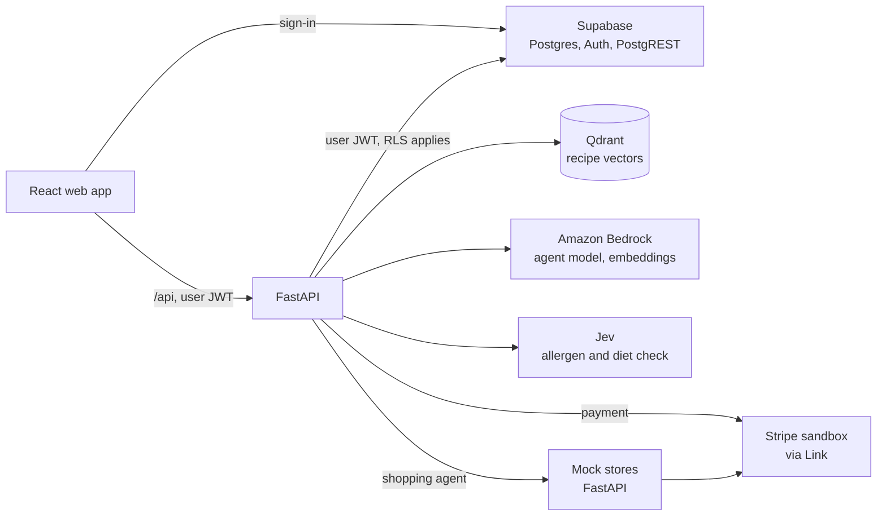

<p align="center">
  
</p>

<p align="center">
  A weekly meal planner for households with allergies, with an AI agent that buys the groceries.
</p>

---

FeedMe turns a household's allergies, diet, tastes, nutrition goals and budget into a week of breakfasts, lunches and dinners. Every recipe is a real one, retrieved from a dataset of 124,000 recipes and checked three times against the household's allergies before it is shown. An AI agent then compares prices across stores, fills a cart and pays for it with a single approved payment.

Built by a team at the **Ensign Build 2026** hackathon.

<!-- TODO: add a screenshot or a short demo GIF here. -->

## How it works

1. **Setup.** The household enters its allergies first, then diet, likes and dislikes, nutrition goals, budget and cooking time.
2. **Plan.** The planner returns a week of meals with alternatives for each slot. Meals can be swapped, and users can add their own recipes.
3. **Grocery.** The plan becomes a grocery list. The buying agent shops for it across six mock stores and pays in Stripe's sandbox after one approval.

## What is interesting in it

### Allergies are enforced three times, never in the search text

Putting "no peanuts" in a search query pulls peanut recipes closer, so nothing the household must avoid is ever part of the search. It is enforced in three other places:

1. **A hard filter in the vector search.** The recipes use about 4,100 distinct ingredient names. A matcher reads each one against an allergen reference of 1,300 terms in 14 groups, and the household's filter is the list of names it rules out. That is why `vanilla yogurt` is blocked for milk and `coconut milk` is not.
2. **The reference again, on the whole recipe.** This pass reads the raw ingredient lines and the cooking steps, which the filter never sees.
3. **A model check.** [Jev](https://typesafe.ai) answers one yes/no question per allergen and per diet for each recipe, as a probability. It catches what a word list can't: brand names, and ingredients that only appear in the steps.

A recipe that could not be checked is left out. If the model check is unavailable, the planner returns an error and no plan. The browser checks each recipe once more before showing it.

### The agent proposes, the code decides

The buying agent is a tool loop over a model on Amazon Bedrock. The model only names a store, a product and the ingredient it is for. Everything that matters is decided in plain code:

- **Prices and quantities** come from the server, never from the model.
- **The spending rules** (budget, store-brand substitutions, uncertain matches) are enforced in the cart service, not in the prompt.
- **The run's summary** is computed from the cart and the orders, not taken from the model's last message.
- **A model that stops early** with an empty or unpaid cart is told what is missing, at most twice.

### One payment for several stores

Checkout uses the Machine Payments Protocol (through [pympp](https://github.com/tempoxyz/pympp)): the store answers `402` with a quote from every store, and the agent pays the total once through Stripe Link. The user approves one payment in the Link app, each store still gets its own order, and no card number reaches the code or the model. Only Stripe sandbox keys are accepted; the app refuses to start with a live key.

### The database enforces the safety rules too

Row level security is on every table. Allergies are add-only, a meal option marked unsafe can't be inserted, and the cart and orders are read-only for users, all at the Postgres level.

## Architecture



The web app talks to Supabase for sign-in only. Every data request goes through FastAPI, which forwards the user's own token so that Postgres decides what that user can see.

## Tech stack

| Layer | Tools |
|---|---|
| Web | React 19, Vite, Tailwind CSS 4, React Router |
| API | Python 3.14, FastAPI, Pydantic |
| Data | Supabase (Postgres, GoTrue, PostgREST), Qdrant |
| AI | Amazon Bedrock (Converse API, Titan Text Embeddings V2), Jev by TypeSafe |
| Payments | Stripe sandbox, Stripe Link over MCP, Machine Payments Protocol |
| Tooling | uv and pnpm workspaces, Docker Compose, pytest, oxlint |

## Repository layout

```
apps/
  api/          FastAPI server: meal planner, allergen matcher, shopping agent, cart, wallet
  storefront/   Six mock grocery stores with a catalog, product feeds and checkout
  web/          React app: Setup, Plan and Grocery
docs/           Backend guide
scripts/        Secret generation, recipe ingestion, an end-to-end run from the command line
supabase/       Database schema and migrations
```

Each app has its own README: [api](apps/api/README.md), [storefront](apps/storefront/README.md), [web](apps/web/README.md).

## Getting started

Prerequisites: Docker, [uv](https://docs.astral.sh/uv/), [pnpm](https://pnpm.io) and Node. uv installs Python 3.14 if it is missing.

### Try the shopping agent with no API keys

The agent has a scripted provider that runs with no model, and the stores are local.

```bash
python3 scripts/gen-env.py      # writes local secrets to .env (git-ignored)
pnpm dev:storefront             # mock stores on http://localhost:8100
```

In a second terminal:

```bash
LLM_PROVIDER=scripted uv run --package api python -m api.agent \
  apps/api/tests/sample_list.json --mode auto --budget 150 --no-pay --pretty
```

The agent searches the six stores, works out the cheapest basket and saves a cart, paying nothing.

### Run the whole app

The planner needs outside services, so add these to `.env` after generating it:

| Variable | For |
|---|---|
| `JEV_API` | The Jev allergen check. Without it the planner answers `503`. |
| `AWS_BEARER_TOKEN_BEDROCK`, `AWS_REGION` | Bedrock, for embeddings and the models |
| `LLM_PROVIDER=bedrock`, `BEDROCK_MODEL_ID` | The model the planner and the agent use |
| `STRIPE_SECRET_KEY`, `STRIPE_PROFILE_ID` | Sandbox checkout. Optional: set `PAYMENTS_ENABLED=false` to stop at the cart. |

```bash
pnpm install
docker compose up -d --wait                      # Supabase and Qdrant
uv run scripts/ingest_recipes.py --limit 200     # embed recipes into Qdrant
pnpm dev                                         # web, API and stores together
```

The web app is at http://localhost:5173, the API at http://localhost:8000 (docs at `/docs`) and the stores at http://localhost:8100.

The recipe dataset is not in the repository. The ingest script expects it at `data/recipes_clean.parquet`.

The full guide, with every route, setting and troubleshooting step, is in [docs/backend.md](docs/backend.md).

## Tests

```bash
uv run --package api pytest apps/api
uv run --package storefront pytest apps/storefront
```

Both suites use stand-ins for Supabase, the stores, Stripe, Link and the models, so they need nothing running. Further tests against a live Supabase and the Stripe sandbox are opt-in; see [docs/backend.md](docs/backend.md#command-line).

## Status

This is a hackathon project, and it is honest about what it does not do yet:

- **A plan takes 25 to 35 seconds**, most of it waiting on the embedding quota.
- **There is no reranker yet.** The interface exists with a stand-in, so side dishes can rank high.
- **The model check's threshold was set on a small sample** of 70 recipes. It needs a larger evaluation before anyone relies on it.
- **The stores are mock stores** with a small catalog, so real recipes often have ingredients none of them sells. The agent buys one pack of each ingredient.
- **Plans and users' own recipes are kept in browser storage**, not in the account.
- **The local stack uses throwaway credentials** and is not meant to be deployed.

Nutrition and allergy information in FeedMe is not medical advice.

## Team

Built at Ensign Build 2026 by Miguel Elizalde and team.

<!-- TODO: list teammates with links, and what each person built. -->

## License

[MIT](LICENSE)
